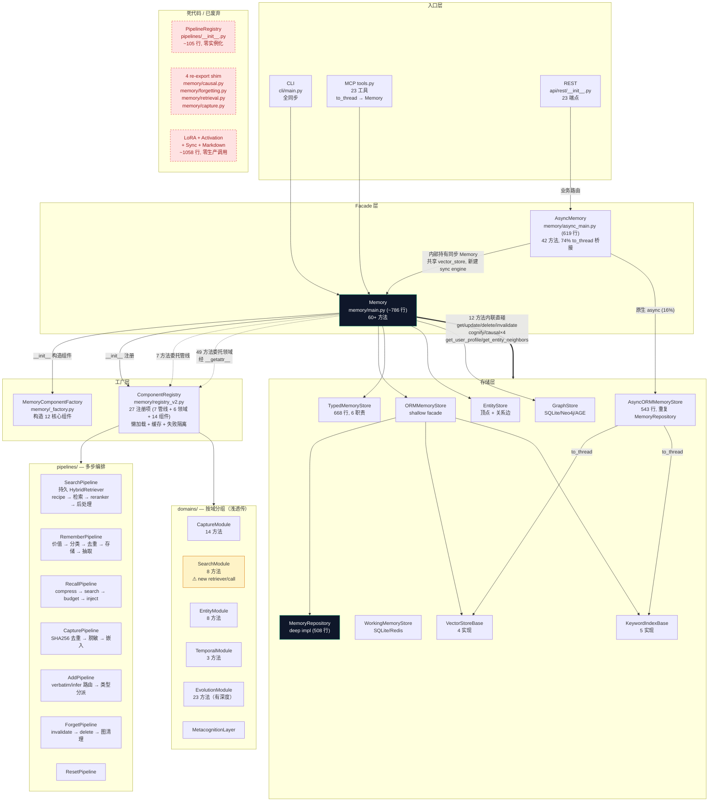
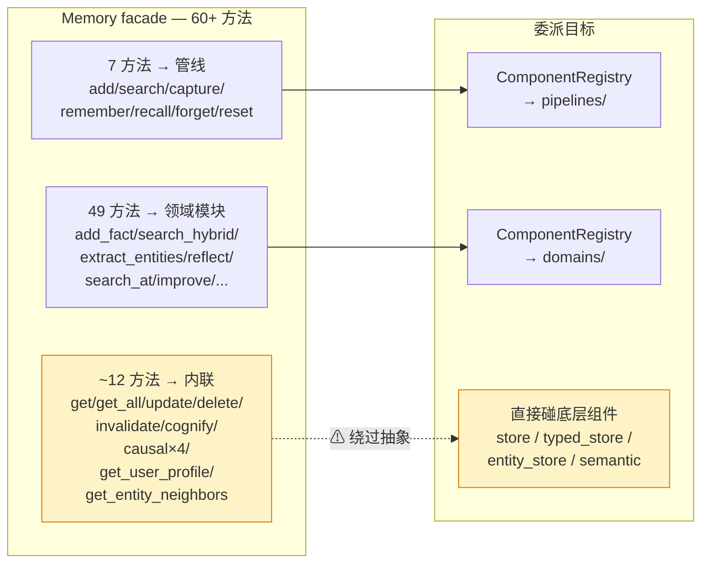
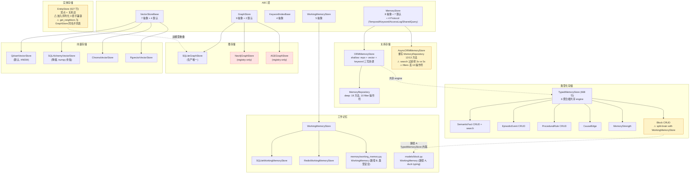

# SeptMuse 架构图

English/中文

读本文档后再改 `src/septmuse/`。术语见 [CONTEXT.md](../CONTEXT.md)，决策见 [Agent Notes](../adr/)。

## 架构总览



## Memory facade 委派路径

facade 有三条委派路径 + 一组内联方法。内联方法绕过管线和领域模块，直接碰底层存储组件。



**内联方法的 leak 点**（facade 有对应领域模块却直碰底层）：

| facade 方法 | 直碰 | 应走的领域模块 |
|---|---|---|
| `get_user_profile` | `self.semantic` | CaptureModule |
| `get_entity_neighbors` | `self.entity_store` | EntityModule |
| `cognify` | 内联构造 `CognifyPipeline` | 无（管线未注册） |
| `add_causal_edge` | `self.typed_store` | 无领域模块 |
| `find_causes`/`find_effects`/`counterfactual` | 内联构造 `CausalRetriever` | 无领域模块 |
| `get`/`get_all`/`update`/`delete`/`invalidate` | `self.store` | 无（CRUD 不属领域模块） |

## 存储层



**存储层摩擦点**：

| 摩擦 | 位置 | 说明 |
|---|---|---|
| WorkingMemory Block 双写 | `typed_store.py:607-663` vs `working_memory_stores/` | 两条活跃路径, 两个同名 `WorkingMemory` 类 |
| 嵌入序列化 3 套 | `entity_store.py:382` (struct.pack) / `typed_store.py:109` (json) / `sqlalchemy_vec.py:95` (json TEXT) | 无一走 VectorStoreBase seam |
| EntityStore 边 vs GraphStore 边 | `entity_store.py:392-449` vs `graph_stores/base.py:42-64` | 两个 `get_neighbors` 同名同语义不同表 |
| AsyncORMMemoryStore 行为分叉 | `async_orm_store.py:193` (3x) vs `orm_store.py:255` (5x) | search 过采样倍数不一致 |
| filters 能力丢失 | `async_orm_store.py:210-216` vs `repositories/memory.py:36-89` | async 侧只支持 `==`, 同步侧 10 操作符 |

## 核心数据流

```
remember: 文本 → RememberPipeline → 价值评估 → 类型分类 → 语义去重 → 捕获 → raw_log → verbatim 存储 → 实体抽取 → 事实抽取 → 冲突检测 → 工作记忆更新

recall: 查询 → RecallPipeline → compress → search → budget → prompt → route → strategy

search: 查询 → SearchPipeline → recipe 解析 → 检索 → reranker → 过期过滤 → 后处理
```

**注意**：`search_hybrid`/`search_progressive`/`search_graph` 不走 SearchPipeline，走 SearchModule——每次新建 HybridRetriever，无 entity boost、无缓存、无 reranker。

## 架构入口

- **facade**：`src/septmuse/memory/main.py` `Memory` 类（零配置入口）— `MemoryComponentFactory.build()` 构造 12 核心组件，`ComponentRegistry.register_all()` 注册 27 项（7 管线 + 6 领域 + 14 组件）
- **AsyncMemory**：`src/septmuse/memory/async_main.py` — REST 专用。42 方法中 31 个纯 `to_thread` 桥接到内部同步 Memory，6 个"原生 async"方法底层仍走 sync vector_store。内部持有同步 Memory + 同步 ORMMemoryStore（新建 sync engine，共享 vector_store/keyword_index）
- **三 API 入口**：
  - CLI：`src/septmuse/cli/main.py`（全同步，走 Memory）
  - REST：`src/septmuse/api/rest/__init__.py` `create_app()` → FastAPI（走 AsyncMemory）
  - MCP：`src/septmuse/api/mcp/tools.py`（23 工具，`to_thread` 到同步 Memory，不经 AsyncMemory）
- **组件注册**：`src/septmuse/memory/registry_v2.py` `ComponentRegistry` — 懒加载 + 缓存 + 失败隔离。`register_all()` 注册 7 管线 + 6 领域模块 + 14 组件。facade 经 `__getattr__` + `_DOMAIN_ATTRS` 映射访问领域模块
- **存储抽象**：`storage/base.py` `MemoryStore` ABC (8 抽象 + 4 Protocol) + `vector_stores/base.py` `VectorStoreBase` (7 抽象, 4 实现) + `keyword_stores/base.py` `KeywordIndexBase` (4 抽象, 5 实现) + `graph_stores/base.py` `GraphStore` (9 抽象, 3 实现) + `working_memory_stores/base.py` `WorkingMemoryStore` (5 抽象, 2 实现)
- **默认后端**：`ORMMemoryStore`（shallow facade）+ `MemoryRepository`（deep impl）+ `TypedMemoryStore`（6 聚合根）+ `EntityStore`（顶点+边）+ `SQLiteGraphStore`。Vector store 默认 `QdrantVectorStore`，降级 `SQLAlchemyVectorStore`
- **配置**：`src/septmuse/configs/base.py` `MemoryConfig`（pydantic）+ `default_config()` 读环境变量
- **治理**：`src/septmuse/governance/access.py` `MemoryState` enum + `check_memory_access_permissions`（4 层）；401 认证（`api/auth.py`）vs 403 授权（`governance/access.py`）
- **共享工具**：`src/septmuse/core/utils.py` — `rrf_fuse()` + `utcnow_iso()`

## 关键设计决策

| 决策 | 说明 |
|------|------|
| **三维正交架构** | 内容类型（工作/情节/语义/程序）× 存储形态（block/向量/图）× 横切关注点（捕获/检索/治理/演化/共享/元认知）。注：文件/激活/参数化三种存储形态零生产调用，见死代码 |
| **零配置** | SQLite + HashEmbedder 默认。`pip install septmuse[onnx]` 升级到 bge-zh (512 dim) |
| **ComponentRegistry** | `registry_v2.py` 取代 `PipelineRegistry`（已死）。统一管管线 + 领域模块 + 组件的懒加载 |
| **facade 三路委派** | 7 方法→管线, 49 方法→领域模块, ~12 方法内联直碰底层。内联方法是抽象 leak |
| **score 统一为相似度 [0,1]** | 向量 cosine、BM25 归一化、RRF 融合 (k=60) 都遵守 |
| **Entity boost** | `0.5/(RRF_K+1)` ≈ 0.008，不劫持排序。仅 SearchPipeline 的持久 HybridRetriever 有此信号 |
| **Bitemporal** | `memories` 表 `valid_at`/`invalid_at`/`expired_at` 三列 |
| **治理分层** | 401 认证 vs 403 授权；state 状态机 (active/paused/archived/deleted)；access-logs 审计 |

## 仓库边界

- **`opensource/`** 是只读参考库（mem0/letta/ReMe/cognee/graphiti/MemOS 源码）— 禁止修改、禁止 import
- **迁移机制**：`storage/migrations/runner.py` `MigrationRunner`，m001-m007 + `schema_version` 表追踪。无 alembic 目录
- **`docs/specs/`** 设计规格、`docs/plans/` 实施计划、`.sdd/` subagent-driven ledger
- **`.codegraph/`** 已索引 — 优先用 `codegraph_explore` 查代码

## 死代码清单

| 文件 | 行数 | 状态 |
|---|---|---|
| `pipelines/__init__.py` PipelineRegistry | ~105 | 零实例化，被 ComponentRegistry 取代 |
| `memory/causal.py` | 20 | re-export shim，零引用 |
| `memory/forgetting.py` | 20 | re-export shim，零引用 |
| `memory/retrieval.py` | 21 | re-export shim，零引用 |
| `memory/capture.py` | 28 | DEPRECATED shim，零引用 |
| `domains/evolution.py` 6 方法 | ~60 | forget/cognify/causal×4 死镜像，facade 全走内联 |
| `storage/parametric/lora.py` | 361 | LoRA 参数化记忆，零生产调用 |
| `storage/activation/__init__.py` | 192 | Activation KV cache，零生产调用 |
| `storage/file_stores/markdown.py` | 234 | Markdown 文件存储，零生产调用 |
| `sync/drift.py` + `sync/synchronizer.py` | 253 | 同步器，零生产调用 |

## Background Evolution（后台演化）

- `evolution/scheduler.py` `EvolutionScheduler`：`threading.Timer` daemon 链，4 任务（forgetting 1h / conflict 5min / distillation 30min / graph 10min）。3 个任务委托 `Memory.evolution.X()`
- `SEPTMUSE_EVOLUTION_ENABLED=false` 禁用；`SEPTMUSE_EVOLUTION_INTERVAL`（默认 300s）控制轮询间隔
- 入口装配：`setup_mcp_server()` startup event 启动调度器；`run_stdio()` 在 try/finally 中启动/停止；`create_app()` lifespan 启动/停止
- `evolution/catchup.py` `LLMCatchUpQueue`：LLM 降级补跑队列（SQLite `septmuse_catchup_queue` 表）。`remember()` 在 LLM 不可用时入队 `fact_extraction`，调度器恢复后消费
- `ORMMemoryStore.get_user_ids()`：走 ABC（`state='active'` 过滤）
- 补跑策略：`fact_extraction` 走 `FactExtractor.extract_and_store()`；其他 task_type 规则版已处理，`mark_completed` 跳过
